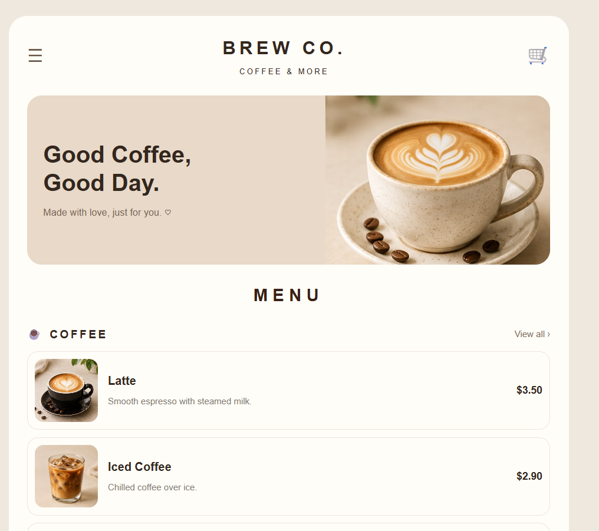
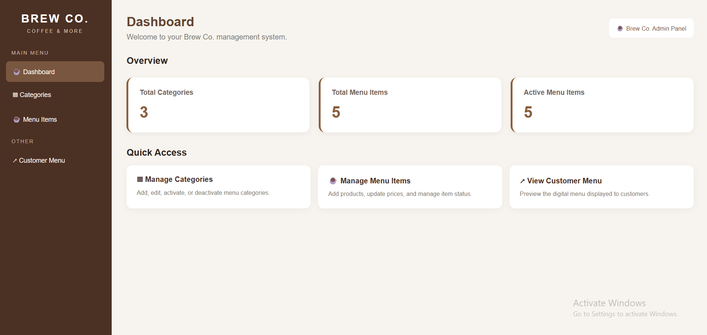

# Brew Co. — QR Menu & Admin Dashboard

A full-stack QR menu web application developed using PHP, MySQL, HTML, and CSS.

The project provides customers with a digital menu and allows administrators to manage categories, menu items, prices, images, and availability through a dedicated admin dashboard.

## Project Overview

Brew Co. was developed as part of my Web Development Internship at Violet Programming.

The goal was to create a user-friendly digital menu that customers could access through a QR code, while providing an administrative interface for managing menu content.

## Features

### Customer Menu
- Responsive digital menu interface
- Menu items organized by category
- Product images, descriptions, and prices
- Coffee, Non-Coffee, and Pastries sections
- Dynamic menu content retrieved from MySQL

### Admin Dashboard
- Dashboard displaying menu statistics
- Add, edit, and delete categories
- Activate or deactivate categories
- Add, edit, and delete menu items
- Upload and manage product images
- Update menu item availability
- Manage product descriptions and prices

## Screenshots

### Customer QR Menu

### Admin Dashboard

## Technologies Used

- PHP
- MySQL
- HTML5
- CSS3
- JavaScript
- XAMPP
- phpMyAdmin
- Git & GitHub

## Database Structure

The application uses a MySQL database named `brew_co_db`.

Main tables:

- `categories` — Stores menu categories and their status.
- `menu_items` — Stores menu items, descriptions, prices, images, category relationships, and status.
- `admin_users` — Stores administrator account information.

The database export is included in the repository:

`brew_co_db.sql`

## Installation and Setup

### Requirements

- XAMPP
- PHP
- MySQL
- Web browser

### Steps

1. Install and open XAMPP.
2. Start Apache and MySQL.
3. Clone or download this repository.
4. Copy the project folder into `C:\xampp\htdocs\`.
5. Open phpMyAdmin at `http://localhost/phpmyadmin`.
6. Create a database named `brew_co_db`.
7. Import `brew_co_db.sql`.
8. Configure the local database connection if required.
9. Open the application in your browser.

### Customer Menu

`http://localhost/brew-co-qr-menu/index.php`

### Admin Dashboard

`http://localhost/brew-co-qr-menu/admin/`

The exact local URL depends on the project folder name.

## My Contribution

As a Web Development Intern at Violet Programming, I worked on:

- Developing the customer-facing QR menu interface.
- Connecting PHP pages to the MySQL database.
- Building category and menu item management features.
- Implementing CRUD operations.
- Handling product image uploads and display.
- Implementing active and inactive status controls.
- Debugging database queries and application errors.
- Improving the responsive layout and overall user experience.

## Technical Challenges

### Database Relationships
Implemented relationships between menu items and categories using MySQL foreign keys.

### Image Management
Handled product image uploads, file paths, and fallback images to ensure menu items displayed correctly.

### Dynamic Content
Connected the customer menu and administrative interface to the same database so changes could be reflected dynamically.

### Admin Functionality
Implemented category and menu item management with create, read, update, and delete operations.

## What I Learned

This project strengthened my practical experience with:

- Full-stack PHP development
- MySQL database management
- CRUD operations
- Server-side form handling
- File uploads
- Debugging and troubleshooting
- Responsive web design
- Git and GitHub

## Project Status

Completed as an internship project.

The application runs locally using XAMPP, PHP, and MySQL.

## Developer

**Sally Kadi**

Junior PHP Full-Stack Developer | PHP, MySQL & JavaScript

- Portfolio: https://sally-kadi.github.io/sally-portfolio/
- GitHub: https://github.com/sally-kadi
- LinkedIn: https://www.linkedin.com/in/sally-kadi/
